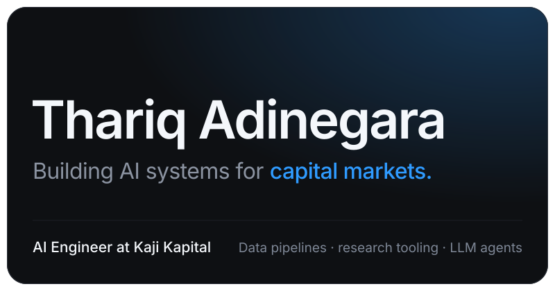
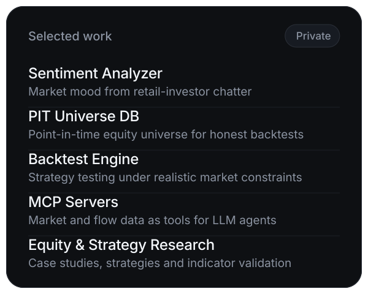
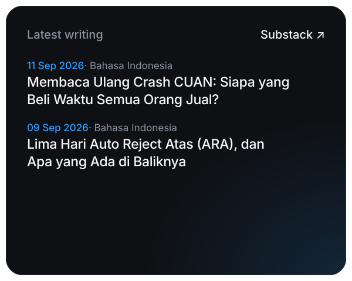
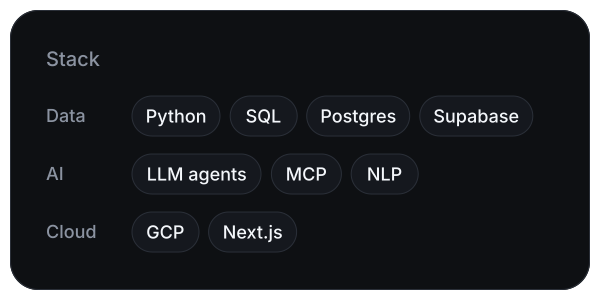

<!-- Bento tiles are generated by scripts/bento.py — edit content there, not the SVGs. Alt text for writing.svg and activity.svg is rewritten on each run. -->

Most of my work is proprietary. Writing here is personal research, not investment advice.

